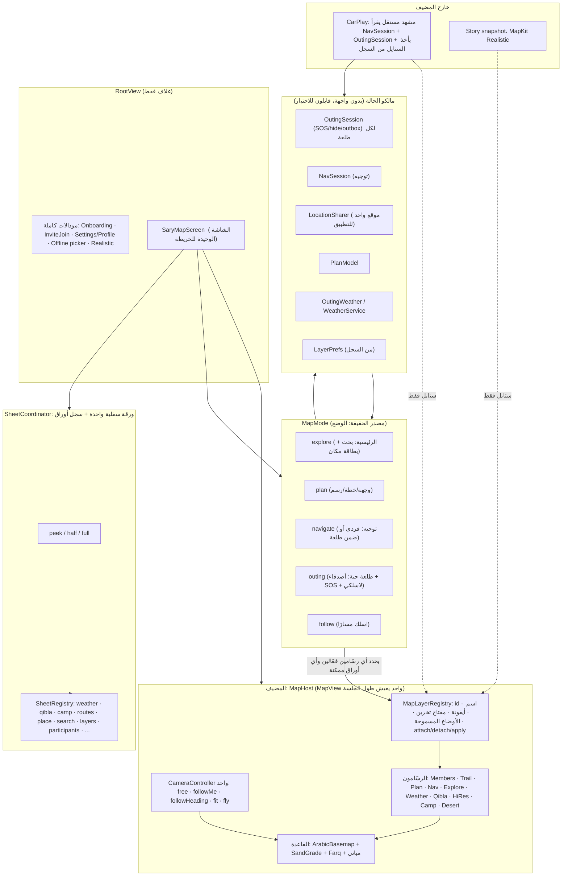

# خريطة واحدة: جرد الشاشات وتصميم التوحيد وخطة الهجرة

المرحلة ١ (تدقيق وتصميم فقط). **ما تغيّر أي ملف Swift في هذا الـPR.**
المصدر: `origin/main` عند `b186fae6` (Build 43). المسارات نسبتها إلى `apps/ios/SaryAlbarq/Sources/` إلا إذا ذُكر غير ذلك.
اللغة: عربي، وأسماء الكود بالإنجليزي.

طلب المالك: «أبي يصير خريطة واحدة، وفيها كل الأكشن للطقس والتنقل والرحلة والطلعة وكل شي»، وزر طبقات واحد في كل شاشة خريطة.

## ٠. كيف نقرأ هذي الوثيقة (وش تحقّقنا منه ووش استنتجناه)

| الوسم | المعنى |
|---|---|
| **[كود]** | قرأته في الملف المذكور (رقم السطر تقريبي ±٥ لأن الملفات تتحرك). |
| **[محاكي]** | شفته على شاشة المحاكي في Build 43 (لقطات في `docs/one-map-shots/`). |
| **[استنتاج]** | تحليل مني، ما جرّبته على الجوال. لازم يُثبت بلقطة قبل الاعتماد عليه. |

حدود اللقطات (أمانة): المحاكي أعطاني ٥ لقطات صالحة: الخريطة الرئيسية، الاستكشاف داخل الطلعة، الطلعة التجريبية، منتقي منطقة الخرائط بلا إنترنت، وخطوة ١ من «طلعة جديدة». لقطات ورقة «الطبقات» وتوجيه «اتجه» وورقة «المزيد» **ما قدرت أثبّتها**: التشغيل التجريبي `-demo` فتح شاشة الترحيب بدل الطلعة في تشغيلات كثيرة وأعطى نتيجة مختلفة في كل مرة (يبدو سباق بين إذن الموقع وحالة التهيئة، [استنتاج]). فهذي الشاشات موصوفة من الكود فقط. وأول لقطة للطلعة التجريبية فيها خريطة بيضاء لأن البلاط ما كان نزل وقت اللقطة، فهي تثبت الواجهة فوق الخريطة بس.

---

## ١. الخلاصة التنفيذية

- التطبيق **ما هو شاشات كثيرة متفرقة**؛ هو **عالمين** يبدّل بينهم `RootView`: [كود `Views/RootView.swift:20-45`]
  1. بدون جلسة طلعة: `HomeView` ← `MapHomeScreen` فوق `PlanMapView`.
  2. فيه جلسة (`model.session != nil`): `LiveOutingHost` ← `LiveOutingScreen` فوق `OutingMapboxView`.
- ثمانية أماكن تنشئ `MapView` أصلية (راجع §٢.٢)، منها **أربعة** تعرض نفس الخريطة للمستخدم: الرئيسية، الطلعة، «اسلك المسار»، «اتجه» القديمة. كل وحدة تحمّل الستايل وتركّب الطبقات بطريقتها.
- لا يوجد `MapLayerRegistry` الآن. الطبقات متفرقة على ٦ مفاتيح `UserDefaults` بأنماط مختلفة، وثلاثة منتقين للطبقة الأساسية، وزر طبقات في الاستكشاف فقط. **الخريطة الرئيسية ما فيها زر طبقات أصلًا** [كود + محاكي: لقطة `home-map.jpg` فيها «موقعي» والقبلة فقط].
- الحل المقترح تدريجي، مو إعادة كتابة: نبدأ بسجل الطبقات والورقة المشتركة، بعدين نوحّد مضيف الخريطة، وبعدين نضم «الرئيسية» و«اتجه» كأوضاع في نفس الشاشة، وأخيرًا نقسم الملفات الضخمة بدون تغيير سلوك.

### أهم خمس تكرارات

| # | التكرار | الدليل |
|---|---|---|
| ١ | **خريطتان لنفس المهمة**: `PlanMapView` (الرئيسية) و`OutingMapboxView` (الطلعة) كلتاهما خريطة Mapbox بالقمر الصناعي بنفس المباني والستايل العربي. لكن الرئيسية بلا طرق Farq ولا طقس ولا صور عالية الوضوح ولا مواقع كشتة ولا اختيار طبقة، والطلعة فيها الكل. | `Map/PlanMapView.swift:44`، `Map/OutingMapboxView.swift:173` |
| ٢ | **ثلاث نسخ لانتقاء الطبقة الأساسية** (قمر صناعي/طبوغرافي/عادي) + ٦ مفاتيح تخزين + زر الطبقات يوجد في وضع الاستكشاف فقط. | `Explore/ExploreViews.swift:198`، `Explore/ExploreViews.swift:645`، `Views/LiveSettingsPage.swift:110` |
| ٣ | **بطاقة المكان مكررة**: بطاقة الرئيسية (`placeCard`) مقابل `PointCard` + «بريف المكان» داخل الطلعة. نفس الأسماء والمسافة والطقس والحفظ والاتجاه، بتصميمين وسلوكين. | `Home/MapHomeScreen.swift:862`، `Plan/PointCard.swift:43` |
| ٤ | **توجيه مكرر**: `StandaloneNavScreen` (خريطة + كاميرا متابعة + مكبّر صوت + قراءة سرعة خاصة فيها) مقابل توجيه الطلعة. اتجاه «اتجه» انتقل فعلًا للطلعة الفردية (`openSolo`)، والشاشة القديمة صارت خلف علم DEBUG لكنها لسا في الكود. نفس الشي لـ«اسلك المسار»: `TrackFollowScreen` مقابل `trackFollow` داخل الطلعة. | `Navigation/StandaloneNavScreen.swift:156`، `Home/HomeTools.swift:18-35`، `Views/TrackFollowScreen.swift:28` |
| ٥ | **حالة القبلة والطقس وموقعي مكررة**: مفتاح القبلة معرّف ٣ مرات بنفس النص؛ حساب `qiblaMapOrigin` منسوخ في شاشتين؛ زر «موقعي» ٤ نسخ؛ ورقة الطقس نسختان (`WeatherSheet` و`WeatherPointSheet`)؛ البحث نسختان (`MapHomeScreen.searchBar` و`LiveSearchSheet`). | `Home/MapHomeScreen.swift:70,982`، `Views/LiveOutingScreen.swift:44,191`، `Qibla/Qibla.swift:319` |

### الخطوة الأولى الموصى بها
**S1: `MapLayerRegistry` + ورقة طبقات مشتركة، ويستعملها وضع الاستكشاف الحالي فقط** (بدون لمس الخريطة الرئيسية). قيمة عالية، خطر منخفض، ويبني القاعدة لكل شي بعدها. التفاصيل في §٨.

---

## ٢. جرد الشاشات وخرائطها

### ٢.١ شجرة الدخول [كود]

```
SaryAlbarqApp (WindowGroup + CarPlay scene)
└─ RootView                                   Views/RootView.swift
   ├─ SplashView                              (launching / identityPending)
   ├─ LiveOutingHost → LiveOutingScreen       (model.session != nil)   ← الخريطة المباشرة
   ├─ DebugScreen                             (DEBUG: -SaryScreen)
   ├─ OnboardingFlow                          (لا هوية أو لا إذن موقع)
   └─ HomeView (NavigationStack)              Screens/HomeView.swift
      ├─ MapHomeScreen  ← الخريطة الرئيسية
      │    ├─ sheets: ProfileSheet, CreateOutingWizard, JoinByLinkSheet, HomeToolSheet
      │    └─ fullScreenCover: StandaloneNavScreen (DEBUG فقط)، TrackFollowScreen
      └─ push(HomeRoute): details, summary, history, profile, settings, recoveryCode,
         appearance, privacy, deleteAccount, notifications, offlineMaps, about, advanced,
         convoyAlerts, blocked, favorites
```
الدعوات: `.sheet(InviteJoinSheet)` من الجذر لما `session == nil`، ومن داخل `LiveSheet` لما فيه جلسة (`Views/RootView.swift:63-66`، `Views/LiveSheet.swift:80-89`). كلاهما لازم يبقى.

### ٢.٢ كل نسخة خريطة [كود]

| # | الملف:السطر | نوع الخريطة | من يفتحها | الطبقات والتحكمات التي تدعمها |
|---|---|---|---|---|
| ١ | `Map/PlanMapView.swift:44` (`MapView`) | Mapbox، ستايل `ArabicBasemap.cachedJSON` (قمر صناعي فقط) | الرئيسية (`MapHomeScreen:92`)، «اتجه» القديمة، محرر الخطة (`PlanEditorView:38`)، منتقي النقطة في المعالج (`CreateOutingWizard:443`)، معاينة الخطة في التفاصيل (`PlanSections:49`, `OutingDetailsView:516`)، معاينة نقطة (`PointCard:264`) | مسار المخطط، وجهة، نقطة مختارة، نقطة موقعي، قبلة، علامات «دليل البر». **بلا**: طبقة أساسية، تضاريس، طقس، صور عالية، كشتة، Farq، سيارات الأصدقاء |
| ٢ | `Map/OutingMapboxView.swift:173` | Mapbox، ٣ طبقات أساسية، تحميل `ArabicBasemap.load(layer)` | `LiveOutingScreen` فقط | الكل: أعضاء، نقطة تجمع، مسارات، علامات مشتركة، خطة، ملاحة (`NavMapDrawer`)، استكشاف، تضاريس ٣D، طقس (`WeatherOverlay.of(map)` السطر ٢٣٧)، قبلة (٢٣٩)، صور عالية (٢٣٣)، كشتة (١٨٥)، Farq (٥٩٠)، مؤثرات بصرية |
| ٣ | `Map/TrackMapView.swift:30` | Mapbox، `MapLayer.satellite.styleURI` ثابت، بدون `ArabicBasemap` | تفاصيل المسار (`TrackViews:114`)، `TrackFollowScreen`، تفاصيل الطلعة (`OutingDetailsView:373`) | مسار، «أنا» بطبقات دائرية خاصة، مسار الاقتراب، صور عالية (ثابتة لشاشة تفاصيل المسار) |
| ٤ | `Screens/OfflineMapsView.swift:271` (`AreaPickerMap`) | Mapbox، `ArabicBasemap.cachedJSON` | «الخرائط بلا إنترنت» | منتقي مستطيل فقط |
| ٥ | `CarPlay/CarPlayMapViewController.swift:46` | Mapbox داخل `CPWindow` | مشهد CarPlay | سيارات، مسار، نقطة تجمع، وجهة، مسار الطريق |
| ٦ | `Explore/MapLayer.swift:151` (`SatelliteImageryProbe`) | DEBUG فقط (لقطات تصوير) | `-SaryScreen imagery` | لا شي |
| ٧ | `Realistic/RealisticMapView.swift:60` | **MapKit** `Map(...)` (صور Apple ثلاثية الأبعاد) | «الوضع الواقعي» (غطاء كامل) | سيارات، مسار، خطة، علامات |
| ٨ | `Story/StoryMedia.swift:13` (`Snapshotter`) | لقطة ثابتة لبطاقة القصة | محرر القصة | بلا تفاعل |
| – | `Navigation/NavPictureInPicture.swift:368` | طبقة فيديو PiP، مو خريطة | أثناء التوجيه | – |

الخريطة ٧ مكتبة مختلفة (MapKit) لسبب مقصود: صور Apple. الخريطة ٥ مشهد UIKit مستقل. الخريطة ٨ لقطة. هذي الثلاث **تبقى منفصلة** لكن تأخذ الستايل والمصادر من السجل (§٥).

### ٢.٣ كل شاشة: الملف، الدخول، الخريطة، التحكمات، الحالة

| الشاشة | الملف | الدخول | الخريطة | أهم التحكمات والبطاقات | حالة تملكها |
|---|---|---|---|---|---|
| الرئيسية | `Home/MapHomeScreen.swift` (١٢٩٢ سطر) | جذر `HomeView` | #١ | شرائح تصنيفات، «البر»، «موقعي»، زر القبلة، ورقة بحث/اختصارات/طلعاتي، بطاقة المكان، ورقة أدوات البر | ~٣٥ `@State` (استعلام، نتائج، كاميرا، مختار، أدوات، غطاء...) |
| الطلعة المباشرة | `Views/LiveOutingScreen.swift` (١٠٩٩) + `Views/LiveSheet.swift` (١١٢٥) | `session != nil` | #٢ | رأس الرحلة، شريط التنبيه، SOS، أزرار جانبية، «اضغط وتكلم»، الزر الرئيسي، ورقة سفلية بثلاث حالات، `LiveModal` بـ٣٥+ حالة | `LiveOutingController` (١٥٦٢ سطر) + `OutingSession` |
| الاستكشاف (وضع داخل الطلعة) | `Explore/ExploreViews.swift` | زر في «المزيد» أو «البر» | #٢ (نفسها) | شريط الطبقات، الكشتة، دروب البر، إحداثية الوسط، درون، واقعي، أماكني | `controller.exploreActive`, `mapLayer`, `terrain3D` |
| «اتجه» (فردية) | نفس الطلعة المباشرة بجلسة فردية (`OutingSession.solo`، `App/AppModel.swift:954`) | زر «اتجه» في بطاقة المكان | #٢ | نفس التوجيه، بدون واجهة المجموعة (`LiveScreenRules.solo`) | `NavSession` |
| «اتجه» القديمة | `Navigation/StandaloneNavScreen.swift` | DEBUG `-SaryStandaloneNav` فقط (`Home/HomeTools.swift:20`) | #١ | شريط تعليمة، سرعة، كاميرا، كتم | `NavSession` ثانية |
| اسلك المسار | `Views/TrackFollowScreen.swift` | الرئيسية (`:1230`)، تفاصيل الطلعة (`OutingDetailsView:208,264`) | #٣ | لوحة المتابعة، اعكس، وجّهني للأقرب | `TrackFollowModel` |
| تفاصيل الطلعة | `Screens/OutingDetailsView.swift` | `HomeRoute.details` | #٣ (مسار)، #١ (خطة) | أعضاء، خطة، مسارات، قصة | – |
| محرر الخطة | `Plan/PlanEditorView.swift` | من الطلعة (`LivePlan:96`) ومن التفاصيل (`PlanSections:22`) | #١ | رسم مسار، تراجع، استيراد GPX | `PlanModel` |
| «طلعة جديدة» | `Create/CreateOutingWizard.swift` (٨٧٥) | الرئيسية (`:140`) | #١ داخل `MapPointPicker` (`:443`) | ٣ خطوات: وجهة، توقيت/طقس، دعوة | `CreateFlow` |
| الخرائط بلا إنترنت | `Screens/OfflineMapsView.swift` | إعدادات، `LiveModal.offlineMaps`، الطبقات | #٤ | منتقي منطقة، تحميل | `OfflineMaps.shared` |
| الطقس (ورقتان) | `Weather/WeatherViews.swift` (`WeatherSheet:218`، `WeatherPointSheet:351`) | شريحة الطقس، «البر»، بطاقة المكان | لا خريطة (طبقات الطقس على #٢) | ٢٤ ساعة، سيول، تحذيرات | `OutingWeather` |
| القبلة | `Qibla/Qibla.swift` + `QiblaMapOverlay.swift` | «البر»، «المزيد» | طبقة على #١ و#٢ | بوصلة، مفتاح «على الخريطة» | مفتاح `sary.map.qibla.visible.v1` |
| كشتة / دروب البر | `Explore/CampSites/*` | شرائح، «البر»، الطبقات | طبقات على #٢، وعلى #١ عبر `DesertOverlay` | أحسن ٥ جلسات، مسارات | `CampSitesHub`, `DesertRoutesHub` |
| السلامة / SOS | `Safety/*`, `UI/Components/SarySOS.swift`, `Views/SOSOverlay.swift` | داخل الطلعة فقط | – | SOS بنافذة مستقلة، إنجاد، غرّزت | `OutingSession` (`sosChoice`, `hideChoice`) |
| الدعوات | `Invites/JoinFlow.swift` | رابط، «انضم برابط» | – | ورقة انضمام | `AppModel.pendingInvite` |
| القصة | `Story/*` | بعد الطلعة | لقطة | بطاقة قابلة للمشاركة | – |
| الإعدادات والملف | `Screens/SettingsScreens.swift`, `Home/ProfileSheet.swift` | `HomeRoute` | – | – | – |
| CarPlay | `CarPlay/*` | مشهد CarPlay | #٥ | قوالب CarPlay | `CarPlayCoordinator` يقرأ `NavSession` و`LiveOutingController` |

---

## ٣. التكرار بالتفصيل (جدول مرجعي)

| # | ما تكرر | النسخة أ | النسخة ب | الأثر | الخطورة |
|---|---|---|---|---|---|
| D1 | خريطة أساسية | `PlanMapView.swift:44` (ستايل `ArabicBasemap.cachedJSON`, `SandGrade.follow`, `BuildingFootprints`) | `OutingMapboxView.swift:173` (+ Farq + بقية الطبقات) | الرئيسية أقل جودة (بلا Farq) وما تتبع الطبقة المختارة. الكاميرا الابتدائية الثابتة على الرياض مكررة (`PlanMapView:~191`, `OutingMapboxView:171`) فينقلب المنظر عند الانتقال الرئيسية ← طلعة [استنتاج من الكود] | عالية |
| D2 | منتقي الطبقة | `ExploreLayersSheet:198` | `ExploreTopBar:645` | نفس الأزرار مرتين في نفس الشاشة | عالية |
| D3 | منتقي الطبقة (إعدادات) | `LiveSettingsPage:110` («الطبقة الافتراضية») | الاثنان فوق | الإعداد يقول بنفسه إن خريطة الطلعة تبقى قمر صناعي: `LiveOutingScreen:88` `layer: exploring ? mapLayer : .satellite`. فالاختيار ما يأثر خارج الاستكشاف | متوسطة |
| D4 | حالة الطبقات | `sary.map.layer.v1` (`MapLayer.swift:79`) | `sary.map.qibla.visible.v1` ×٣، `sary.map.campSites.v1`، `sary.map.weather.v1` + `rainDays.v1`، `sary.map.osmTracks.v1`، `terrain3D` (متغير في المتحكم، مو مخزّن)، `HiResSettings.userKey` | لا مكان واحد لمعرفة «وش مشغّل» | عالية |
| D5 | القبلة | `MapHomeScreen:70,982` + زر `:237` | `LiveOutingScreen:44,191` + `Qibla.swift:319` | نفس المنطق (عمر الإحداثية ≤ ١٢٠ ث، دقة ≤ ٥٠٠ م) منسوخ؛ الرئيسية تقبل أيضًا `OneShotLocator` وهذا فرق غير مقصود [استنتاج]. الطلعة ما فيها زر على الخريطة، فقط داخل ورقة القبلة | متوسطة |
| D6 | زر «موقعي» | `MapHomeScreen:224` | `SaryMapControls:160`، `ExploreViews:179`، `LiveOutingController+FollowCamera:22`، `StandaloneNavScreen:175` | ٤-٥ نسخ بتصاميم مختلفة (دائرة خاصة مقابل `SaryMapControlButton`) | متوسطة |
| D7 | بطاقة المكان | `MapHomeScreen:862 placeCard` | `Plan/PointCard.swift:43` + `PlaceBriefSection` | نصوص وأزرار مختلفة؛ «الجو هناك» في الرئيسية مقابل «بريف المكان» في الطلعة | عالية |
| D8 | البحث | `MapHomeScreen:546 searchBar` + `PlaceSearch` | `LivePlan:234 LiveSearchSheet` + `WhereToSheet` (`OutingFlowViews:90`) | المعامل `destinationPicker` في `MapHomeScreen:11` **كود ميت**: أحد ما يمرره (`MapHomeScreen(` يُستدعى مرة واحدة في `HomeView:78`)، والتعليق فوقه يدّعي أن البحث داخل الرحلة يستعمله [كود] | متوسطة |
| D9 | التوجيه | `StandaloneNavScreen` (كاميرا `PlanCamera` كل ٣ ث، `NavSpeedCluster`، كتم) | الطلعة (`FollowCamera`, `navSideItems`, `LiveSheet` شريط الملاحة) | نسختا كاميرا متابعة | منخفضة (الأولى خلف DEBUG) |
| D10 | متابعة مسار | `TrackFollowScreen:28` + `TrackMapView` | `LiveOutingController+Follow.swift` + `OutingMapboxView` | نفس `TrackFollowModel` بخريطتين | متوسطة |
| D11 | نقطة «أنا» | `PlanUserLocationPin` (في `PlanMapView`) | طبقات `sary-track-me` في `TrackMapView:~105`، وسيارة `drawCar` في `OutingMapboxView:1145` | ثلاث رسمات | منخفضة |
| D12 | كاميرا | `PlanCamera` (`PlanMapView`) | `MapCameraRequest` (`OutingMapboxView:78`) + `FollowCamera` (`Map/FollowCamera.swift`) | نموذجان للكاميرا | متوسطة |
| D13 | ورقة الطقس | `WeatherSheet:218` (الطلعة) | `WeatherPointSheet:351` (نقطة، الرئيسية والطلعة `.weatherAt`) | بنفس المصدر لكن مكوّنان | منخفضة |
| D14 | أدوات البر | `LiveModal` (٣٥ حالة، `LiveOutingController:32`) | `HomeTool` (`HomeTools.swift:6`) | مسجّلا أوراق منفصلان؛ الجسر `DesertToolsHost` (`DesertRouteSheet.swift:19`) موجود ويعمل [كود] وهو **نقطة بداية جيدة** | متوسطة |
| D15 | رسم المسار والخطة | `PlanEditorView` (رسم على `PlanMapView`) | ضغطة طويلة في الطلعة (`controller.planLongPress`) + `MapPointPicker` | ثلاث طرق لتحديد/تحرير نقاط | متوسطة |

ما **ليس** تكرارًا (يبقى): `RealisticMapView` (مكتبة مختلفة)، CarPlay (مشهد UIKit مستقل)، لقطة القصة.

---

## ٤. التصميم المستهدف: خريطة واحدة

### ٤.١ خريطة المعمارية المستهدفة (قبل خطوات الهجرة)



الفكرة بجملة: **خريطة واحدة تعيش، والأوضاع والأوراق تتغير فوقها**. الجلسات (`OutingSession`، `NavSession`) تبقى مالكة الحالة وخارج الواجهة، والخريطة ما تملك منطق أعمال.

### ٤.٢ المبادئ
١. `MapHost` يملك `MapView` واحد ولا يُهدم عند الانتقال بين الرئيسية والطلعة (يزيل D1، ويمنع قفزة الرياض).
٢. كل شي يُرسم على الخريطة هو **طبقة مسجّلة** في `MapLayerRegistry` (راجع §٥). ما في مكان ثاني يستدعي `XOverlay.of(map)`.
٣. الأوضاع (`MapMode`) تحدد مين يظهر: أي طبقات فعّالة، وأي أزرار، وأي ورقة سفلية. الوضع **مشتق** من الحالة (جلسة؟ توجيه؟ متابعة؟) مو متغير ثاني يتزامن يدويًا.
٤. ورقة سفلية واحدة بثلاث ارتفاعات. المحتوى يتبدل بحسب الوضع. الأوراق الصغيرة تسجّل نفسها في `SheetRegistry` بدل `enum LiveModal` الضخم و`HomeTool`.
٥. زر طبقات واحد على الخريطة في كل الأوضاع، يفتح نفس الورقة.

### ٤.٣ الأوضاع

| الوضع | يُشتق من | الورقة السفلية | ما يظهر على الخريطة |
|---|---|---|---|
| **explore** | لا جلسة، لا توجيه | بحث، اختصارات، طلعاتي (الحالية في `MapHomeScreen`) | شرائح التصنيفات، علامات «دليل البر»، قبلة، موقعي |
| **plan** | مكان مختار أو تحرير خطة | بطاقة مكان موحّدة (`PointCard` + بريف) أو محرر الخطة | وجهة، مسار مخطط، مقابض رسم |
| **navigate** | `NavSession.phase != .idle` (فردي أو ضمن طلعة) | شريط الملاحة (الحالي) | مسار، تعليمات، سرعة، «رجّعني للتوجيه» |
| **outing** | `session != nil && !isSolo` | الورقة الحالية (أصدقاء، قافلة، نقاط) | سيارات، نقطة تجمع، مسارات، SOS، PTT |
| **follow** | `trackFollow != nil` | لوحة المتابعة | مسار مبرز، «أنا»، الاقتراب |

الطلعة الفردية = `outing` بلا واجهة المجموعة + `navigate`، وهذا بالضبط ما يحصل اليوم (`LiveScreenRules.solo`). الاستكشاف الحالي داخل الطلعة (`LiveContext.exploring`) يبقى **لاحقة** فوق أي وضع إلى أن تنتقل أدواته (طبقات، تضاريس، إحداثية الوسط) إلى الورقة المشتركة.

### ٤.٤ ما يبقى شاشة كاملة منفصلة، ولماذا

| الشاشة | السبب |
|---|---|
| الترحيب `OnboardingFlow` | قبل وجود هوية وإذن موقع؛ ما فيها خريطة |
| الإعدادات، الملف، الحساب، الخصوصية، حذف الحساب (`HomeRoute`) | نماذج، ما لها علاقة بالخريطة |
| انضمام الدعوة `InviteJoinSheet` وشرح الموقع | تدفق شرعي يخلق حساب ويطلب إذن؛ لازم يكون ورقة معزولة فوق أي وضع |
| الخرائط بلا إنترنت (منتقي المنطقة) | يحتاج مستطيل تحديد وخريطة بحالة مختلفة؛ يستعمل ستايل السجل بس |
| الوضع الواقعي | MapKit، مكتبة أخرى |
| ملخص الطلعة، السجل، القصة | محتوى بعد الطلعة |
| CarPlay | مشهد UIKit مستقل (قيد المنصة) |
| SOS الشاشة الكاملة لصديق (`FriendSOSAlertHost`) | نافذة مستقلة عن عمد، فوق كل شي |

### ٤.٥ أين يروح كل زر موجود (خريطة نقل)

| الزر/الإجراء الحالي | مكانه الحالي | مكانه الجديد |
|---|---|---|
| شرائح التصنيفات (مطاعم...) | `MapHomeScreen:171` | الورقة السفلية، وضع explore (نفس الشرائح) |
| «البر» (طقس/قبلة/كشتة/دروب) | شريحة `:204` + `LiveQuickRow` + `ExploreTopBar` | **ورقة البر** واحدة من `SheetRegistry`، تفتح من الورقة السفلية في كل الأوضاع |
| «موقعي» | ٥ نسخ (D6) | `MapControlCluster` واحد (موقعي/تتبعني/باتجاهي) في كل الأوضاع |
| زر القبلة على الخريطة | الرئيسية فقط | طبقة «القبلة» في السجل؛ تُشغّل من ورقة الطبقات |
| «الطبقات» | استكشاف فقط | زر ثابت على الخريطة في كل الأوضاع (§٦) |
| منتقي الطبقة بالأعلى (`ExploreTopBar`) | استكشاف | يتحول إلى اختصار داخل ورقة الطبقات (أو شريط مصغّر يقرأ من السجل) |
| الطقس (شريحة الرأس + `WeatherSheet` + طبقات الطقس) | الطلعة | شريحة الطقس تبقى في الرأس (outing/navigate)؛ ورقتا الطقس تندمجان لاحقًا؛ **طبقات** الطقس تصير مدخلًا في السجل |
| «اتجه» | بطاقة المكان (الرئيسية) ← `openSolo` | زر في بطاقة المكان الموحّدة؛ يحوّل الوضع إلى navigate بدون هدم الخريطة |
| «أنشئ طلعة» / «وجّه القافلة» | بطاقة المكان | نفسها (بطاقة موحّدة) |
| الكشتة، دروب البر | شرائح + أوراق (`LiveModal.campSuggest/desertRoute`, `HomeTool.camp/routes`) | `SheetRegistry` + طبقتان في السجل |
| SOS | داخل الطلعة | يبقى في outing/navigate-ضمن-طلعة، نافذة مستقلة (`SOSOverlayHost`)؛ ما يتحرك |
| «اضغط وتكلم» | outing | outing فقط |
| «أنهِ الطلعة»، «غادر» | «المزيد» | بلا تغيير |
| «أماكني ومساراتي» | استكشاف | ورقة في السجل، من أي وضع |
| «درون» و«واقعي» | استكشاف | تبقى أدوات الاستكشاف؛ «واقعي» يفتح الغطاء المنفصل |
| بحث «وين رايحين؟» | الرئيسية + `LiveSearchSheet` + `WhereToSheet` | مكوّن بحث واحد (`PlaceSearchSheet`) يُمرَّر له الهدف (وجهة/نقطة/ساق) |

---

## ٥. `MapLayerRegistry`: نقطة التسجيل الواحدة

### ٥.١ الواجهة المقترحة (تصميم، مو كود جاهز)

```swift
/// تعريف طبقة. يُسجَّل في مكان واحد فقط: MapLayerCatalog.all
protocol MapLayerDescriptor {
    var id: MapLayerID { get }              // "base.satellite", "weather.rain", "qibla", "camp", "osmTracks"...
    var group: MapLayerGroup { get }        // .base, .overlay, .terrain, .data
    var title: String { get }               // عربي
    var systemImage: String { get }
    var storageKey: String { get }          // مفتاح واحد بنمط sary.map.layer.<id>.v1 (+ تهجير من القديم)
    var availableIn: Set<MapMode> { get }   // أين تظهر في الورقة
    var needsNetwork: Bool { get }
    var defaultOn: Bool { get }
    func attach(to map: MapView) -> MapLayerHandle   // يعيد مقبض للتحديث/الفك
}
```
`MapLayerRegistry` يملك: القائمة، الحالة الحالية (`@Published`)، القراءة/الكتابة للتخزين، وربط `attach/detach` بدورة حياة الستايل (إعادة التركيب بعد `loadStyle`).

ملاحظة مهمة [كود]: النمط **موجود أصلًا** بصورة جنينية: `WeatherOverlay.of(map)`, `QiblaMapOverlay.of(map)`, `HiResImagery.of(map)` كلها «كائن مربوط بـ`MapView` عبر `objc_setAssociatedObject`» (`Qibla/QiblaMapOverlay.swift:24-30`). التسجيل يوحّد هذا النمط ولا يخترع نمطًا جديدًا.

### ٥.٢ كيف نضيف طبقة جديدة (نقطة التسجيل الواحدة)
١. كتابة `MyLayer: MapLayerDescriptor` (ملف واحد: الوصف + `attach`).
٢. إضافته لسطر واحد في `MapLayerCatalog.all`.
٣. اختبار الوحدة الإلزامي: `MapLayerRegistryTests` يتحقق أن كل طبقة في الكتالوج لها معرّف فريد ومفتاح فريد وأوضاع وعنوان، وأن ورقة الطبقات تعرضها تلقائيًا.
ما نعدّل: لا ورقة، لا شاشة، لا `OutingMapboxView`. (هذي القاعدة رقم ٢ في §١١.)

### ٥.٣ جرد الطبقات الحالية (اللي ينتقل للسجل)

| الطبقة | التعريف الحالي | المفتاح الحالي |
|---|---|---|
| قمر صناعي / عادي / طبوغرافي | `MapLayer` (`Explore/MapLayer.swift:7`) | `sary.map.layer.v1` |
| تضاريس ثلاثية الأبعاد | `controller.terrain3D` | غير مخزّن |
| صور عالية الوضوح | `HiResSettings` (`Map/AIEnhance`) | `HiResSettings.userKey` |
| طقس (سحاب/مطر/ربيع) | `WeatherLayersSection`, `WeatherLayers.swift:104` | `sary.map.weather.v1`, `rainDays.v1` |
| أماكن كشتة | `CampSitesLayerSection`, `CampSitesMapLayer.swift:11` | `sary.map.campSites.v1` |
| مسارات البر (OSM) | `OffroadTracks`, `ExploreViews:191` | `sary.map.osmTracks.v1` |
| القبلة | `QiblaMapOverlay` | `sary.map.qibla.visible.v1` (مكرر ×٣) |
| دليل البر / مسارات مقترحة | `DesertGazetteerMapLayer`, `DesertRouteLayers` | لا مفتاح (مرتبطة بسياق) |
| أماكني / مساراتي (GPX) | `MapExplore` | `SavedPlacesStore`, `TrackLibrary` |
| مؤثرات بصرية (درون، تدرج الرمل) | `MapVisualsHub` | إعدادات الطلعة |

---

## ٦. زر الطبقات وورقتها (السلوك)

- **زر واحد** على الخريطة في كل الأوضاع، أيقونة `square.3.layers.3d` (نفس أيقونة الاستكشاف الحالية)، المعرّف `map.layers` (يحل محل `explore-layers`). يوضع في عمود أزرار الخريطة اليمين، ما يدخل الشريط العلوي.
- **ورقة واحدة** `MapLayersSheet`: ارتفاعان (medium/large). الترتيب: ١) الخريطة الأساسية (٣ بطاقات)، ٢) طبقات البيانات بمفاتيح (طقس بفترة، كشتة، مسارات البر، القبلة)، ٣) التضاريس والصور العالية، ٤) «الخرائط بلا إنترنت» كصف يفتح غطاء منفصلًا. الصفوف مولّدة من `MapLayerCatalog` بحسب `availableIn`، فلا شي ينكتب يدويًا.
- **الحالة**: تُحفظ فورًا في `MapLayerRegistry`؛ كل شاشات الخريطة تقرأها، فالطبقة اللي اخترتها في الرئيسية تبقى في الطلعة (يحل D3).
- **الطبقة الأساسية**: تحل D2 (نسختان) و D3 (الإعداد). صفحة «الطبقة الافتراضية» في الإعدادات تُحذف لاحقًا (بعد إثبات) لأن اختيار الورقة صار هو الافتراضي.
- **حالة التوجيه**: أثناء `navigate` تبقى الورقة متاحة لكن بدون خيارات تغيّر الكاميرا (مثل التضاريس ٣D) إلا بعد التوقف، مثل قاعدة «الوضع الواقعي وأنت واقف» الحالية (`LiveOutingScreen:483`).
- **أثناء القيادة**: الزر بحجم `theme.mapButton` (٦٤ في وضع القيادة) وبدون تسمية.
- **البلا شبكة**: كل صف `needsNetwork` يظهر معطّلًا مع سبب بالعربي، بدون إخفاء.

---

## ٧. المخاطر وما يمكن أن ينكسر (وكيف نحميه)

| المنطقة | الخطر [استنتاج من الكود] | الحماية المطلوبة |
|---|---|---|
| **سباقات SOS و«أخفِ موقعي»** | `OutingSession` يملك `sosChoice`/`hideChoice`/`sosWanted`/`hideWanted` (`App/OutingSession.swift:1157-1164`) ويعيد المحاولة بعد إعادة الظهور (`reRaiseSOS` `:1169`). إذا نقلنا أي منطق من هذا للواجهة أو غيّرنا دورة حياة الجلسة (إنشاء/إغلاق عند تبديل الوضع) انكسر. | **ممنوع** تغيير `OutingSession` في خطوات التوحيد. الجلسة تبقى كما هي، والخريطة تقرأها فقط. اختبارات `HideLocationTests`, `SafetyTests`, `SOSAlwaysUITests` تُشغّل قبل وبعد كل خطوة. |
| **مشاركة الموقع** | `LocationSharer` واحد في `AppModel`. `StandaloneNavScreen` يستدعي `watchForeground`/`requestFreshFix` ويوقفها في `onDisappear`. توحيد الخريطة يغيّر مين يشغّل ومين يوقف. | إبقاء أوامر الموقع في `OutingSession`/`NavSession`، لا في الشاشة. اختبارات `BackgroundShareTests`, `AlwaysLiveTests`, `GpsQualityTests`. |
| **CarPlay** | يقرأ `NavSession` و`LiveOutingController` عبر `CarPlayFeatureSource` (`CarPlay/CarPlayWiring.swift:123`). أي إعادة تسمية/نقل لخصائص المتحكم تكسره بصمت (مشهد منفصل ما يظهر في اختبارات الشاشة). | `CarPlayWiringTests`, `CarPlayPresenterTests`, `CarPlayManeuverTests` قبل وبعد. لا ننقل خصائص يقرأها CarPlay إلا بغلاف توافق مؤقت. |
| **الروابط والدعوات** | عرض الدعوة له مسارين حسب وجود جلسة (`RootView:63`، `LiveSheet:80`). لو الشاشة صارت واحدة لازم المسارين يتحولان لمسار واحد بدون أن تضيع الدعوة أو تُعرض مرتين. | `JoinFlowTests`, `InviteeArrivalTests`, `PersonalInvitesUITests`, واختبار جديد: دعوة أثناء الاستكشاف / أثناء التوجيه. |
| **طابور الأفعال دون اتصال** | `PendingActionQueue`/`outbox` مرتبطة بـ`OutingSession` (`:292-300`). يتأثر لو تغيّر وقت إغلاق الجلسة. | `OutingStateTests`, `ParkedSessionTests`, اختبار جديد لسيناريو «أخفِ موقعي بدون شبكة ثم تبديل الوضع». |
| **الطلعة الفردية** | `openSolo` يغلق الجلسة الفردية السابقة ويقفل المعلّقة (`AppModel:954-975`)؛ ملخصها يُحفظ في `soloSnapshots`. تغيير توقيت الهدم قد يفقد الملخص. | `ParkedSessionTests`, `TripAutoNavTests`, `LiveEndedUITests`. |
| **أداء** | إبقاء `MapView` حيًا ثم إضافة/إزالة طبقات دوريًا يزيد استهلاك الذاكرة؛ حاليًا الرئيسية تُهدم عند فتح الطلعة. | قياس `PerfSignpost` (`launchToMap`, `liveFirstCar`) قبل/بعد على جهاز. |
| **الستايل واللغة** | الرئيسية بلا Farq: دمجها سيغير شكلها (أفضل لكنه تغيير بصري). | لقطات قبل/بعد، متغير واحد في كل مقارنة (قاعدة إثبات المظهر). |
| **ملفات ضخمة** | `OutingMapboxView` ٢٤٢٥ سطر و`LiveOutingController` ١٥٦٢ فيها كل شي مترابط. التوحيد فوقها قبل فصلها يزيد الاحتكاك. | خطوات فصل المنطق (§٩ ب) قبل خطوات التوحيد المتقدمة، وتقسيم الملفات بعد الاستقرار. |

---

## ٨. خطة الهجرة (تدريجية، كل خطوة تُدمج وتُشحن لحالها)

### ٨.١ المنهج (إلزامي)
- **تحسين تدريجي، مو إعادة كتابة.** كل تغيير مستقل. اختبارات قبل وبعد. **ما نحذف النظام القديم قبل ما يثبت البديل** (يعيش خلف علم أو بالتوازي حتى إثبات التكافؤ ثم يُحذف في PR منفصل).
- لا تغييرات واسعة متزامنة: PR واحد = جزء واحد من الخريطة.
- حافظ على استقرار البنائات الحالية: كل PR يمر بحزمة الدخان (٣ اختبارات UI على الأقل + الوحدات المعنية) قبل أن يُشحن.
- الترتيب حسب قرار المالك: (١) جرد الشاشات (هذا الـPR) ← (٢) خريطة قاعدة + سجل طبقات + منتقي موحد + نقطة تسجيل واحدة ← (٣) فصل المنطق عن الواجهة ← **التوحيد (دمج الأوضاع)** ← (٥) اختبارات التراكب والواجهة (تُشغَّل بالتوازي من البداية وتسبق أي دمج مضيف) ← (٦) ملف قواعد المطور ← (٧) توثيق كل ميزة ← **(٤) تقسيم الملفات الضخمة في النهاية، بعد التوحيد.**

### ٨.٢ الخطوات

مصطلحات الاختبارات: **U** = وحدة (Tests/)، **UI** = XCUITest، **S** = لقطات محاكي مطلوبة (إثبات بالبكسل، قاعدة واحدة متغيّرة في كل مقارنة).

#### المرحلة أ: جرد (القرار ١)
| # | الخطوة | الملفات | الاختبارات | الإثبات |
|---|---|---|---|---|
| S0 | هذا الـPR: الوثيقة فقط | `docs/ONE-MAP-UNIFICATION.md`, `docs/one-map-shots/*` | لا شي (وثيقة) | مراجعة المالك |

#### المرحلة ب: خريطة قاعدة + سجل الطبقات (القرار ٢)
| # | الخطوة | الملفات | الاختبارات | الإثبات |
|---|---|---|---|---|
| **S1** | `MapLayerRegistry` + `MapLayerCatalog` + طبقات القاعدة فقط (قمر/عادي/طبوغرافي) **بجانب** `MapLayer` الحالي (بدون حذف). يقرأ من `sary.map.layer.v1` نفسه | جديد: `Map/Layers/MapLayerRegistry.swift`, `MapLayerCatalog.swift` | **U** `MapLayerRegistryTests`: معرّفات فريدة، مفاتيح فريدة، قراءة/كتابة، قيمة افتراضية، تهجير مفتاح قديم، `availableIn` | لا تغيير بصري (S: لقطة استكشاف قبل/بعد متطابقة بكسليًا لنفس الطبقة) |
| S2 | `MapLayersSheet` مشتركة تقرأ من السجل، وتستبدل `ExploreLayersSheet` **داخل الاستكشاف فقط**؛ القديمة تبقى خلف علم DEBUG لمقارنة ثم تُحذف في S3 | `Explore/ExploreViews.swift` (تفويض)، جديد `Map/Layers/MapLayersSheet.swift` | **U** توليد الصفوف من الكتالوج؛ **UI** `LayersToggleUITests.testLayersSheetSwitchesFlip`, `ExploreUITests.testEnterFromActionsAndSwitchLayers`, `CampSitesUITests.testLayerToggleInLayers`, `testWeatherLayersToggleAndRainPeriodAreReachable` (موجودة) + جديد `LayersSheetUITests.testRowsMatchCatalog` | S: ورقة الطبقات (medium/large، فاتح/داكن، حجم خط كبير) |
| S3 | ضم طبقات البيانات للسجل: طقس، كشتة، OSM، قبلة (مفتاح واحد بدل ٣)، صور عالية، تضاريس. كل واحدة `MapLayerDescriptor` بدون تغيير رسمها | `Weather/WeatherLayersSection.swift`, `Explore/CampSites/CampSitesMapLayer.swift`, `Qibla/*`, `Map/AIEnhance/HiResViews.swift` | **U** `WeatherLayersTests`, `CampSitesTests`, `QiblaTests` (موجودة) + `LayerMigrationTests` (قيمة المفتاح القديم تنتقل) | S: تشغيل/إطفاء كل طبقة وصورتها على الخريطة (متغير واحد لكل لقطة) |
| S4 | حذف `ExploreTopBar` منتقي الطبقة المكرر (D2) → اختصار يقرأ السجل؛ حذف `ExploreLayersSheet` القديمة. **بعد** إثبات S2/S3 | `Explore/ExploreViews.swift` | **UI** `ExploreUITests.*` | S: شريط الاستكشاف |
| S5 | زر `map.layers` في عمود أزرار **الطلعة** في كل الأوضاع (بدل زر الاستكشاف فقط) | `Views/LiveOutingScreen.swift` (`exploreSide`/`sideItems`), `UI/Components/SaryMapControls.swift` | **UI** جديد `LayersButtonUITests.testVisibleInStoppedDrivingExploring`؛ `SOSAlwaysUITests` ما ينكسر؛ **U** `LiveCalmTests` (ما يكسر قاعدة «زرين كحد أقصى» إلا بقرار) | S: الطلعة واقف / قيادة / استكشاف، SE و Pro Max |
| S6 | زر الطبقات + الورقة على **الخريطة الرئيسية**، مع تطبيق الطبقة الأساسية على `PlanMapView` (يحل D1 جزئيًا: الاختيار فقط، لا Farq بعد) | `Home/MapHomeScreen.swift`, `Map/PlanMapView.swift` | **UI** `HomeFlowUITests` جديد: `testLayersButtonOnHome`, `testHomeFollowsChosenBase`؛ **U** `HomeFlowTests` | S: الرئيسية بكل طبقة (٣ لقطات)، وبعد فتح طلعة تبقى الطبقة نفسها |
| S7 | توحيد منطق القبلة/الموقع الحديث: `MapOrigin.fresh(...)` (دالة نقية) يستعملها الشاشتان (D5) | جديد `Qibla/QiblaOrigin.swift` | **U** `QiblaTests` + حالات الحدود (١٢٠ ث، ٥٠٠ م، الموقع الأحادي) | لا بصري |
| S8 | طبقات المسار/الخطة/الملاحة/الأعضاء كواصفات (غير مرئية للمستخدم؛ تنظيم داخلي) | `Map/OutingMapboxView.swift` (استدعاءات فقط) | **U** `MapPortTests`, `NavigationTests` | S: توجيه، سيارات: متطابقة قبل/بعد |

#### المرحلة ج: فصل المنطق عن الواجهة (القرار ٣)
نفصل **فقط** ما نحتاجه قبل كل دمج لاحق، كل واحدة PR مستقل مع اختبارات تكتب قبل النقل:

| # | الخطوة | يُستخرج من | إلى (وحدة بلا واجهة) | الاختبارات |
|---|---|---|---|---|
| S9 | حالة الرئيسية (استعلام، نتائج، تصنيف، مختار، أدوات) | `MapHomeScreen.swift` (~٣٥ `@State`) | `HomeMapModel` (`ObservableObject`) | **U** جديد `HomeMapModelTests`؛ `HomeFlowTests`, `BilingualSearchTests` |
| S10 | قرارات الكاميرا (`PlanCamera` + `MapCameraRequest` + `StandaloneNavRules.followDue`) | `PlanMapView`, `OutingMapboxView`, `StandaloneNavScreen` | `MapCameraModel` واحد (قواعد نقية) | **U** `FollowCameraTests` + جديد `MapCameraModelTests` |
| S11 | بطاقة المكان: حساب الاسم/المسافة/الإجراء (`HomePlaceAction`, `PlaceBriefRules`) | `MapHomeScreen.placeCard`, `PointCard` | `PlaceCardModel` | **U** `PlaceBriefTests`, `HomeFlowTests` |
| S12 | سجل الأوراق: `SheetRegistry` بدل `LiveModal` و`HomeTool` (تدريجيًا: ورقة بورقة) | `LiveOutingController.swift:32`, `HomeTools.swift` | `Sheets/SheetRegistry.swift` | **U** `SheetRegistryTests`؛ **UI** `ScreensUITests`, `PlaceBriefUITests` |

#### المرحلة د: اختبارات التراكب والواجهة (القرار ٥) — **قبل** أي دمج مضيف
| # | الخطوة | المحتوى |
|---|---|---|
| S13 | حزمة `OverlapUITests`: على iPhone SE وPro Max وiPad، أحجام خط عادية و`accessibility1`، فاتح/داكن: لا قص ولا تراكب بين (شرائح التصنيفات، زر الطبقات، «موقعي»، SOS، الورقة السفلية، بطاقة المكان، بطاقة التنبيه، لوحة الملاحة)؛ تمرير المحتوى في الورقة الكبيرة؛ البطاقات العائمة ما تغطي المس. تُقاس بـ`ChromeFramesKey` الموجود (`LiveOutingScreen.swift:4`) | **UI** `OverlapUITests.*`, **U** `ChipLayoutTests`, `RespondiveLayout` إن وجد؛ **S** لقطات كل الأحجام |

#### المرحلة هـ: توحيد المضيف والأوضاع (هذا هو «خريطة واحدة»)
| # | الخطوة | الملفات | الاختبارات | الإثبات |
|---|---|---|---|---|
| S14 | `MapHost`: تغليف مشترك لتحميل الستايل (`ArabicBasemap`, `SandGrade`, Farq, مباني) تستعمله `PlanMapView` و`OutingMapboxView` و`TrackMapView` و`AreaPickerMap` و`CarPlayMapViewController` (٥ مواقع إنشاء `MapView`). **بدون** دمج الشاشات | جديد `Map/Host/MapStyleHost.swift` | **U** `MapPortTests`, `CarPlayWiringTests`, `MapVisualsTests`؛ **UI** الدخان | S: الرئيسية صارت بنفس شوارع Farq (لقطة قبل/بعد، التغيير الوحيد) |
| S15 | طبقات الطقس/كشتة/صور عالية/Farq على `PlanMapView` عبر السجل (الرئيسية تحصل على كل ما في الطلعة) | `Map/PlanMapView.swift` | **UI** `CampSitesUITests`, `HomeFlowUITests` جديدة `testHomeShowsCampLayer` | S: الرئيسية مع كل طبقة |
| S16 | وضع `follow` و`navigate` الفردي داخل `SaryMapScreen` الحالية (طلعة)؛ **حذف** `StandaloneNavScreen` (خلف DEBUG أصلًا) و`HomeCover.nav`. `TrackFollowScreen` تتحول إلى وضع `follow` فوق خريطة الطلعة | `Home/HomeTools.swift`, `Navigation/StandaloneNavScreen.swift`, `Views/TrackFollowScreen.swift` | **UI** `NavigationUITests`, `TrackFollowUITests`, `TripUITests`, `BackTrackUITests`؛ **U** `HomeFlowTests` (قواعد `StandaloneNavRules` تُنقل لا تُحذف) | S: اتجه من الرئيسية، اسلك المسار؛ **شرط**: بقاء الكاميرا (ما ترجع للرياض) |
| S17 | **مضيف خريطة واحد حي**: `MapHost` يعيش في `RootView` وتحته يتبدّل `MapMode` بدل هدم `PlanMapView` وإنشاء `OutingMapboxView`. الرئيسية والطلعة تصيران وضعين لنفس الشاشة (`explore` ← `outing`). **أخطر خطوة**، لذلك خلف علم تشغيل (`sary.oneMap`) ودفعتين: TestFlight داخلي أولًا | `Views/RootView.swift`, `Screens/HomeView.swift`, `Views/LiveOutingScreen.swift` | كل **U** و**UI** المذكورة في §٧ + `SOSAlwaysUITests`, `HideLocationTests`, `CarPlay*Tests`, `JoinFlowTests`, `ParkedSessionTests`, `OutingStateTests`؛ جديد `OneMapUITests.testHomeToSoloToHomeKeepsCamera/SOSOverHome/InviteDuringNav` | S: الانتقال رئيسية ← اتجه ← وصول ← رئيسية بدون وميض؛ أداء `PerfSignpost` على جهاز |
| S18 | بطاقة مكان واحدة (`PlaceCardModel`) تستبدل `placeCard` و`PointCard` في كل الأوضاع؛ بحث واحد؛ حذف الكود الميت `destinationPicker` | `Home/MapHomeScreen.swift`, `Plan/PointCard.swift`, `Plan/LivePlan.swift` | `PlaceBriefUITests`, `PlanUITests`, `HomeFlowUITests`, `BilingualSearchShotsUITests` | S: بطاقة مكان في الرئيسية وفي الطلعة متطابقة |
| S19 | حذف النسخ القديمة بعد استقرار علمين: `PlanMapView` كخريطة رئيسية (يبقى للمعاينات)، `LiveModal`/`HomeTool` المنتهية، `LiveSettingsPage.defaultLayer`، `ExploreTopBar` | متعددة | الدخان + الحزمة الكاملة ليلًا | S: مراجعة نهائية |

#### المرحلة و: قواعد المطور وتوثيق الميزات (القراران ٦ و٧)
| # | الخطوة | |
|---|---|---|
| S20 | يُنقل الملحق §١١ إلى `docs/DEVELOPER-RULES.md` بعد مراجعة المالك لهذا التدقيق (PR وثائق فقط)، ويُضاف فحص CI خفيف (سكربت `scripts/check-rules.sh`: يمنع `MapView(frame` خارج `Map/Host/`، ويمنع `enum .*Layer.*Picker`) |
| S21 | وثيقة لكل ميزة: الوصف، مكانها في الكود، اختباراتها (`docs/features/<name>.md`)، تُكتب مع كل خطوة أعلاه ومو دفعة واحدة؛ القالب في §١٢ |

#### المرحلة ز: تقسيم الملفات الضخمة (القرار ٤) — في النهاية، بعد التوحيد، **بلا تغيير سلوك**
القاعدة: لا يبدأ تقسيم ملف إلا إذا غُطّي سلوكه باختبارات (تُضاف أولًا إن نقصت)، ويُقسَّم PR واحد لكل ملف، والأسطر تتحرك فقط (نقل، بدون إعادة صياغة).

| الملف (أسطر اليوم) | التقسيم المقترح (بحسب `MARK` الموجودة) | الاختبارات الحامية |
|---|---|---|
| `Map/OutingMapboxView.swift` (٢٤٢٥) | `MapViewRepresentable` (التمثيل) · `MapCoordinator+Style` (`styleLoaded/setLayer/labels/terrain`) · `+Cars` (`sync/drawCar/chips`) · `+Trails` · `+Camera` · `+Follow` · `+Roads` · `MapChips.swift` (MapChip/MapNote/RallyPin) · `ArabicBasemap.swift` | `MapPortTests`, `FollowCameraTests`, `ChipLayoutTests`, `DrivingRealismTests`, `MapVisualsTests` |
| `App/OutingSession.swift` (١٧٣٢) | `+PrivacyGate` · `+Lifecycle` · `+Sharing` · `+Nearby` · `+Trail` · `+Inbound` · `+Actions` · `+InstantActions` · `+Hide` · `OutingSession+Solo` (المقاطع محددة بـ`MARK` من `:280` إلى `:1645`). **أخطر ملف**: يُقسّم آخرًا ومعه اختبارات سباق SOS/hide | `HideLocationTests`, `SafetyTests`, `OutingStateTests`, `ParkedSessionTests`, `BackgroundShareTests`, `AlwaysLiveTests` |
| `Live/LiveOutingController.swift` (١٥٦٢) | `LiveModal.swift` (إلى `SheetRegistry`) · `+State` · `+Trails` · `+Alerts` · `+Camera` · `+Actions` · `+Participants` · `+SOS` · `+Rally` · `+Invite` · `+Stations` · `+PTT` (يوجد أصلًا 13 امتداد) | `LivePresenterTests`, `ConvoyTests`, `OutingFlowTests`, `LiveDeclutterTests` |
| `Home/MapHomeScreen.swift` (١٢٩٢) | `HomeMapModel` (S9) · `HomeSheet` · `HomeSearchBar` · `HomeResultsList` · `HomeCategoryChips` · `HomeMapControls` · `HomeStateCards` (active/upcoming/start/failed/invite) | `HomeFlowTests`, `HomeFlowUITests`, `BilingualSearchTests` |
| `App/AppModel.swift` (١١٥٣) | `AppModel+Identity` (`:308`) · `+Outings` (`:493`) · `+Solo` (`:940`) · `+Invites` · `+Debug` | `AccountDeletionTests`, `PushRegistrarTests`, `ParkedSessionTests`, `JoinFlowTests` |
| `Views/LiveSheet.swift` (١١٢٥) | `LiveSheet` · `LiveQuickRow` (`:292`) · `LiveRaisedSheet` (`:411`) · `LivePanels` (`:556`) · `InviteTab` · `NoteComposer` · `NearestStations` · `RallyLabel` · `ShareSheet` | `ScreensUITests`, `LiveCalmTests` |
| `Views/LiveOutingScreen.swift` (١٠٩٩) | `LiveOutingScreen` · `LiveTopStack` · `LiveChrome` · `EdgeArrowLayer` · `LiveFit` | `OverlapUITests` (S13) |
| `CarPlay/CarPlayCoordinator.swift` (١٠٧١) | `+Lifecycle` · `+Input` · `+Buttons` · `+NoOuting` · `+Members` · `+Trips` · `+Search` · `+TripPreview` · `+Alerts` · `+PTT` · `+SOS` · `+Debug` · `MapTemplateDelegate` | `CarPlayWiringTests`, `CarPlayPresenterTests`, `CarPlayManeuverTests` |

### ٨.٣ لماذا هذا الترتيب
- **الطبقات أولًا (S1-S8)**: أقل خطرًا (طبقة عرض)، أعلى قيمة ظاهرة للمالك (زر واحد)، وتبني السجل الذي تحتاجه كل خطوة لاحقة.
- **فصل المنطق (S9-S12) قبل دمج المضيف**: نقل حالة الرئيسية من ~٣٥ `@State` لنموذج مختبر يجعل الدمج تبديل عرض لا تبديل سلوك.
- **اختبارات التراكب (S13) قبل الدمج**: أي دمج سيحرّك العناصر العائمة؛ بدون شبكة قياس نكتشف القص بعد الشحن.
- **المضيف الحي (S17) متأخرة وخلف علم**: هي الوحيدة التي تغيّر دورة حياة الخريطة.
- **التقسيم أخيرًا**: تقسيم ملف ٢٤٠٠ سطر ثم تعديله بالتوحيد يضاعف التعارضات؛ الأفضل نوحّد على الملف الموجود ثم نقسّمه بلا تغيير سلوك.

---

## ٩. مقارنة بالوضع الحالي لكل شاشة: ماذا يتغير للمستخدم

| الآن | بعد التوحيد |
|---|---|
| الرئيسية قمر صناعي فقط وبدون طبقات/طقس/كشتة | نفس الخريطة بكل الطبقات وزر طبقات |
| «اتجه» تبدّل الشاشة كلها وتبدأ الخريطة من الرياض [استنتاج] | نفس الخريطة، الورقة تتبدل |
| زر الطبقات في الاستكشاف فقط | في كل مكان |
| الاختيار في الإعدادات ما يأثر خارج الاستكشاف | الاختيار واحد ويسري على كل مكان |
| بطاقتا مكان مختلفتان | بطاقة واحدة |
| «موقعي» بخمسة أشكال | شكل واحد |

---

## ١٠. قرارات الأسئلة المفتوحة (٢٠٢٦-١١-١٢، قرار وكيل الدمج بتفويض المالك)
١. **تتذكّر الخريطة الرئيسية آخر طبقة اختيرت** (الافتراضي الأول: قمر صناعي كما اليوم).
٢. **زر القبلة يبقى اختصارًا مستقلًا** بجانب زر الطبقات، ويظهر أيضًا في الورقة.
٣. **شرائح التصنيفات** تظهر في وضعي الرئيسية والاستكشاف، وتختفي أثناء الطلعة الحية (تبقى متاحة من البحث)؛ تقليلًا للازدحام.
٤. **S17 بعلم داخلي** على TestFlight الداخلي أولًا، ولا يُفعَّل للخارجي قبل اجتياز S1-S16 وS13 (اختبارات التراكب).
ترتيب التنفيذ المعتمد: S1 ثم S2 ثم S3...، كل خطوة PR مستقل. الأقدم في هذا القسم أدناه للتاريخ.

## ١٠. الأسئلة الأصلية للمالك (تحتاج قرار قبل S6/S17)
١. الخريطة الرئيسية الآن قمر صناعي دائمًا: هل نجعل الافتراضي الجديد «ما اخترته آخر مرة» (سلوك مختلف عن اليوم)؟
٢. زر «القبلة» على الخريطة الرئيسية اليوم زر مستقل: نخليه كاختصار بجانب زر الطبقات أم يدخل الورقة فقط؟
٣. هل تبقى شرائح التصنيفات (مطاعم، مقاهي...) ظاهرة أثناء الطلعة الحية (وضع outing) أم في explore فقط؟ اليوم هي في الرئيسية فقط.
٤. هل نبدأ S17 (المضيف الحي) بعلم داخلي على TestFlight الداخلي، أم ننتظر حتى تنتهي S1-S16 في بناء أو اثنين؟

---

## ١١. ملحق: قواعد المطور (مسودة، تصير `docs/DEVELOPER-RULES.md` بعد مراجعة المالك)

خمس قواعد يفرضها المالك:

١. **لا خريطة جديدة لميزة تقدر الخريطة المركزية تستوعبها.** أي ميزة تحتاج عرض على خريطة تُسجَّل كطبقة أو وضع في المضيف الواحد، ولا تنشئ `MapView` ولا `Map(...)` جديدة إلا بموافقة مكتوبة (الاستثناءات الحالية: CarPlay، MapKit الواقعي، لقطة القصة، منتقي منطقة الأوفلاين).
٢. **لا منتقي طبقات جديد.** نقطة التسجيل الوحيدة هي `MapLayerCatalog`، والواجهة الوحيدة هي `MapLayersSheet`.
٣. **لا منطق أعمال ولا حسابات داخل ملفات الواجهة.** الواجهة تعرض وتنقل الأحداث فقط. القرارات (متى نعرض، كم المسافة، أي إجراء) في وحدات بلا واجهة، ولها اختبارات وحدة.
٤. **لا تقسيم ولا إعادة هيكلة لملف قبل وجود اختبارات تحمي سلوكه الحالي.** تُكتب الاختبارات وتنجح على الكود القديم أولًا، ثم يتحرك الكود، ثم تنجح نفسها.
٥. **لا ميزة جديدة قبل تحديد مكانها في المعمارية واختبارها.** كل ميزة تبدأ بمسودة صفحة: أي وضع، أي ورقة، أي طبقة، أي مالك حالة، وأي اختبار، قبل أول سطر Swift.

قواعد المنهج المرافقة: تغيير تدريجي لا إعادة كتابة؛ كل تغيير مستقل؛ اختبارات قبل وبعد؛ لا حذف للنظام القديم قبل إثبات البديل؛ لا تغييرات واسعة متزامنة؛ البنائات الحالية تبقى مستقرة؛ لا يُعلن إن ميزة بصرية تعمل بدون لقطة بكسل من المحاكي أو الجهاز.

---

## ١٢. ملحق: قالب توثيق الميزة (`docs/features/<name>.md`)

```
# اسم الميزة
- الوصف (جملتان)
- الوضع/الورقة/الطبقة التي تعيش فيها
- الكود: الملفات الرئيسية (مسار:اسم النوع)
- مالك الحالة (الجلسة/النموذج) ومفاتيح التخزين
- الاختبارات: وحدة (Tests/...) و UI (UITests/...) و لقطات
- المخاطر المعروفة (SOS/موقع/CarPlay/دعوات/دون اتصال)
```

---

## ١٣. أدلة اللقطات (محاكي iPhone 18 Pro، iOS 27.2، Build 43 من `main`)

| الملف | الشاشة | ما يثبته [محاكي] |
|---|---|---|
| `docs/one-map-shots/home-map.jpg` | الرئيسية (`-SaryScreen home`) | شرائح تصنيفات، «البر»، «موقعي» وزر القبلة، ورقة بحث/اختصارات. **لا زر طبقات** |
| `docs/one-map-shots/live-explore.jpg` | الاستكشاف داخل الطلعة | شريط الطبقات الثلاث + زر `الطبقات` + الكشتة + دروب البر + عمود جانبي (درون/واقعي/أماكني) + إحداثية الوسط: كل شي غير موجود في الرئيسية |
| `docs/one-map-shots/live-demo-peek.jpg` | الطلعة التجريبية | رأس الرحلة، SOS، «موقعي»، «وصلنا»، «اضغط وتكلم»، ورقة سفلية بـ«البر/المحادثة/التجمع/المزيد» (الخريطة بيضاء: البلاط لم ينزل لحظة اللقطة) |
| `docs/one-map-shots/offline-area-picker.jpg` | منتقي منطقة الأوفلاين | خريطة ثالثة مستقلة (#٤) |
| `docs/one-map-shots/create-wizard-step1.jpg` | «طلعة جديدة» الخطوة ١ | زر «اختر من الخريطة» الذي يفتح #١ داخل `MapPointPicker` |

**لم تُلتقط** (محاولات فاشلة، دليل كودي فقط): ورقة الطبقات، «اتجه» الفردية، «المزيد»، `TrackFollowScreen` (ظهرت شاشة البداية بدل المحتوى)، تفاصيل الطلعة (رسالة «تعذّر التحميل» لأن العرض التجريبي لا يملك خادمًا).

---

## ١٤. حدود هذا التدقيق (أمانة)
- كل أرقام الأسطر من `main@b186fae6`، وستتحرك مع كل PR.
- الجرد غطى `Sources/` فقط؛ ما راجعت `Widgets/` و`ShareExtension/` (لا خرائط فيهما حسب `grep`).
- لم أقِس الأداء ولا الذاكرة؛ التوصية بإبقاء `MapView` حيًا (S17) فرضية تحتاج قياسًا قبل الاعتماد.
- ادعاء «الكاميرا تعود للرياض عند الانتقال» مبني على قراءة `makeUIView` (`OutingMapboxView:171`) ولم أثبته بلقطة.
- لم أشغّل اختبارات الوحدة ولا UI في هذه المرحلة (وثائق فقط)؛ أسماء الاختبارات الجديدة المقترحة (`LayersButtonUITests` وغيرها) غير موجودة بعد، وما كان بلا علامة «جديد» موجود فعليًا في `Tests/` أو `UITests/`.
